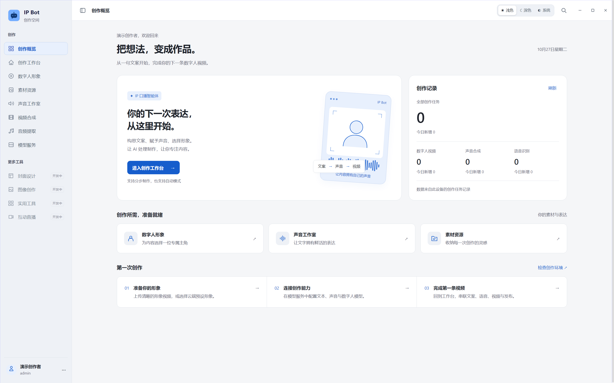

# IP Bot

[中文文档](README.md) · [Contributing](CONTRIBUTING.md) · [Security](SECURITY.md)

IP Bot is an Electron/Vue 3 workspace for digital-human video production. It combines script learning and rewriting, speech synthesis, avatar management, subtitles and video composition. A separate Express/SQLite backend manages accounts, devices, subscriptions, quotas and provider settings.

## Project focus

The project focuses on **engineering integration and workflow automation**: connecting existing models, media tools and publishing adapters into a coordinated desktop workflow. It is suitable for learning workflow orchestration, researching model-service integration and validating AI video prototypes.

With compatible runtimes, configured services and authorized media, automatic mode can coordinate enabled steps: extract reference speech → rewrite the script → synthesize speech with a selected voice → generate an avatar video → add subtitles and music → prepare titles and tags → create a cover → hand off to platform publishing.

Publishing adapters cover Douyin, WeChat Channels, Kuaishou and Xiaohongshu. Actual publishing depends on account access, current platform behavior and verification requirements; some steps require human confirmation. End-to-end publishing on every platform has not been validated in this developer preview.

The desktop app, admin backend and some media processing run locally. Model generation uses cloud providers or compatible local services depending on configuration. The source package does not include complete models or media runtimes, and the project does not guarantee video quality or audience reach.

This is a **developer preview**, validated on Windows x64 with Node.js 22. The maintainer authorized Apache-2.0 for the changes while preserving upstream attribution. Known dependency and TypeScript issues remain documented in [release status](docs/RELEASE_STATUS.md).

[Illustrated walkthrough (Chinese)](README.md#界面导览) · [Step-by-step installation guide (Chinese)](docs/INSTALL.md)

**The source download does not include local avatar models or the complete media runtime. Providing an API key alone does not enable every feature.** Cloud avatar workflows still need compatible provider configuration and the media runtime used by local processing.

## Windows first launch

With Node.js 22 available, extract the source and run the backend batch launcher first, then the desktop launcher. First launch creates an ignored private configuration and installs missing dependencies. Existing credentials are preserved. Missing media runtimes produce guidance while the interface remains accessible; generation still requires the appropriate resources. Read startup errors above the pause prompt and inspect the ignored logs directory.

## Setup

~~~sh
npm ci
npm --prefix user-server ci
npm run init:local
~~~

The initializer creates an ignored local sensitive.config.json with a random JWT secret. Existing configuration is preserved. Optionally copy .env.example to .env. Precedence: process environment, nonempty .env entries, local JSON. Restart after changes. Never commit real provider credentials.

## Runtime resources

The repository excludes FFmpeg, DLLs, embedded Python, browsers, pretrained weights, local avatar runtimes, third-party fonts/music and private data. A fresh source checkout alone cannot perform the complete video workflow. Supply legally obtained compatible resources; no cleared public runtime bundle is currently provided.

~~~sh
node scripts/import-runtime-resources.cjs "D:/your-existing-project"
npm run check:runtime
~~~

Add --with-local-models to import an existing local avatar environment. The importer adds missing files and does not copy account databases. See [runtime requirements](docs/RUNTIME.md).

## Run

~~~sh
# Terminal A
npm run start:server
# Terminal B, after preparing runtime resources
node scripts/launch.cjs desktop
~~~

Admin page: http://127.0.0.1:3002/admin/admin.html . The first account registered in the desktop app becomes administrator. Complete bootstrap locally; subsequent users need an invitation generated by an administrator. There is no default password or reusable built-in activation code.

For interface development only, npm run dev starts Vite; a regular browser does not provide Electron's native functionality. Windows batch launchers are included.

## Security boundary

Use this application for trusted local/self-hosted installations. The backend binds to loopback by default. Anonymous callers cannot read provider credentials; authenticated desktop clients can read configured credentials because provider calls are performed on the client. This architecture is not a secret-isolating public multi-tenant service. Do not give untrusted users access to shared paid credentials. Remaining dependency vulnerabilities and inherited TypeScript failures are documented rather than claimed resolved.

## Checks and layout

~~~sh
npm test
npm run audit:source
npm run build
npm run typecheck
npm audit
npm --prefix user-server audit
npm run export:source
~~~

src contains Vue UI; electron contains IPC/native services; user-server contains the account backend and admin UI; python contains processing scripts and separately licensed MODNet source; scripts contains installation/build/audit tooling; tests uses temporary isolated databases; docs describes architecture, runtime and release limitations. Runtime binaries and application data remain local and ignored.

## License and attribution

Existing AIGCPanel / ModStartLib Apache-2.0 attribution and LICENSE are preserved. The maintainer confirmed Apache-2.0 for the changes. See NOTICE and THIRD_PARTY_NOTICES.md. Model weights, media, fonts, brands and provider terms require separate permission.
