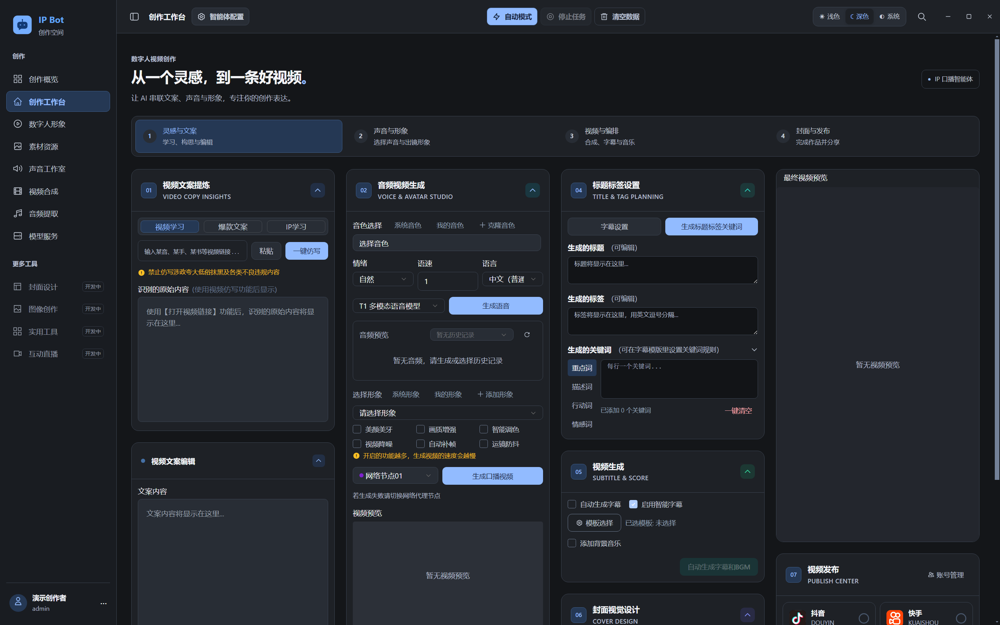
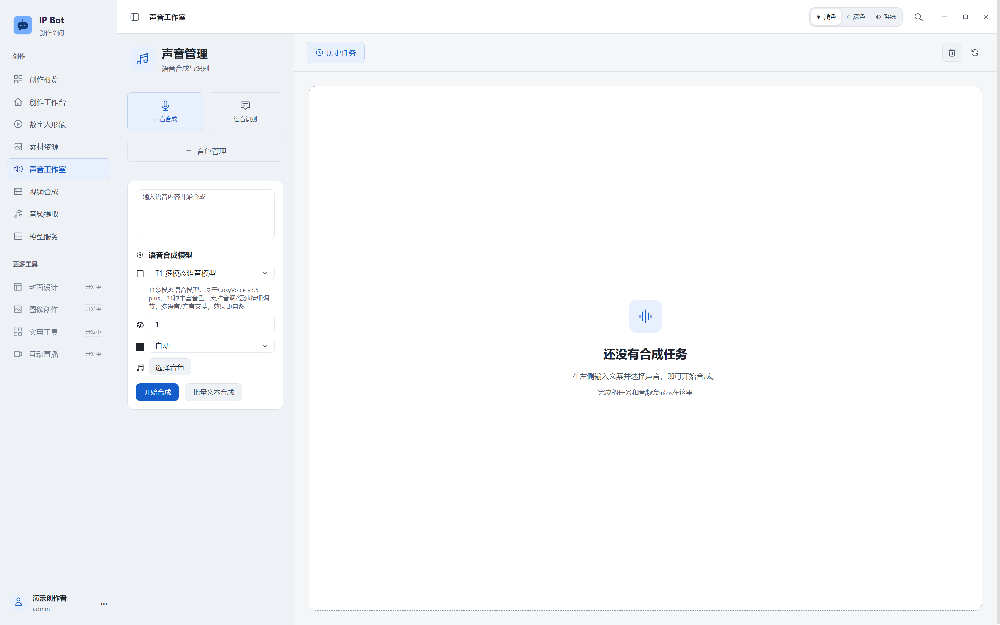

# IP Bot · 数字人视频创作工作台

## 📌 项目简介

IP Bot 是一个面向 **AI 数字人口播视频的流程整合与自动化创作项目**，将文案处理、语音合成、数字人驱动、视频后期和多平台发布接入同一个桌面工作台，并提供独立的用户与配置管理后台。

项目重点是 **工程整合与流程自动化**：连接已有模型和媒体工具，让各个创作环节可以协同运行。适合用于学习工作流编排、研究模型服务集成，以及验证 AI 视频系统原型。

## 🎬 一键串联数字人口播创作

在运行资源、模型服务、素材和平台账号准备就绪后，可通过自动模式串联已启用的步骤，也可以逐步执行、检查结果并调整参数：

1. **提取参考文案**：从可访问且有权使用的视频中识别口播内容。
2. **改写与重组文案**：调整表达、语义和结构，形成新的创作稿。
3. **生成配音**：选择系统音色或个人克隆音色，将文案合成为语音。
4. **生成数字人口播**：将音频与所选形象交给配置好的数字人服务处理。
5. **添加字幕**：按所选设置完成识别、时间轴与字幕样式处理。
6. **添加背景音乐**：使用自己的音乐素材，配置配乐和混音。
7. **生成标题与标签**：辅助整理视频标题、标签及关键词。
8. **制作视频封面**：在工作台内按模板和参数生成封面。
9. **衔接多平台发布**：接入抖音、视频号、快手和小红书的发布流程。

多平台发布已包含对应适配代码，实际执行需要有效登录状态，并受平台页面变化、账号权限和验证流程影响；遇到验证或待确认状态时，需要人工完成后续操作。当前开发预览未对所有平台完成端到端发布验证。

## ✨ 功能特性

- **文案处理**：参考视频内容提炼、语义改写与结构重组。
- **声音创作**：音色管理、音色克隆接入、语音合成与试听，能力取决于所选服务。
- **数字人生成**：形象管理，以及云端或兼容本地数字人服务的接入。
- **视频后期**：字幕、背景音乐、标题、封面和音视频编排。
- **流程编排**：在同一工作台串联创作步骤，支持自动模式与分步操作。
- **发布衔接**：多平台账号与发布流程适配，保留必要的人工确认环节。
- **本机工作台**：桌面界面、管理后台和部分媒体处理在本机运行；模型调用按所选方案使用云服务或兼容的本地服务。

自动化帮助减少重复操作，成片质量与传播效果仍取决于素材、模型、选题和人工审核。源码包不包含完整模型与媒体运行环境，详见下方的安装说明。

**开发预览说明：** 维护者已确认按 Apache-2.0 发布新增修改，并保留上游归属。当前仍有依赖安全告警与历史类型问题，见 [发布状态](docs/RELEASE_STATUS.md)。目前适用于受信任的本机自部署，尚无完整公开安装包。

**English:** IP Bot is an Electron/Vue desktop workspace for digital-human video creation, with script rewriting, speech synthesis, media composition and an Express/SQLite administration backend. Bring your own provider credentials and licensed runtime resources. See [English README](README.en.md).

从文案、声音到形象与视频，在一个工作台里完成创作。截图来自当前版本的隔离演示账号；没有使用真实用户数据或服务商密钥。

**先看界面 → [界面导览](#界面导览)　准备安装 → [完整安装部署教程](docs/INSTALL.md)　了解包里有什么 → [下载内容与模型](#下载内容与模型)**

## 下载内容与模型

**GitHub 提供源码，不包含整套数字人模型。下载后仅填写 API，不能直接使用全部视频功能。**

| 你使用的内容 | 是否含本地数字人模型 | 还需要什么 |
| --- | --- | --- |
| GitHub 克隆 / Source code ZIP | 否 | Node.js、npm 依赖、合法媒体运行资源、个人服务配置 |
| 已有的完整本地安装目录 | 可能包含既有模型与媒体环境 | 运行资源预检、个人 API 配置与模型启动验证 |
| 云端数字人模式 | 使用云端模型，无需本机数字人权重 | 云服务权限/额度、匹配的工作流、基础媒体运行资源 |
| 本地数字人模式 | 权重与模型服务自行准备 | 兼容的本地服务、驱动、硬件和有权使用的形象素材 |

文案、语音和数字人是不同服务：只做文案改写，不代表已准备好视频合成；云端模式也仍可能需要本机 FFmpeg/Python 完成下载、字幕或音视频处理。当前没有经再分发许可核验的公开运行资源包。

~~~mermaid
flowchart TD
    A[下载源码] --> B[安装 Node.js 22 与 npm 依赖]
    B --> C[初始化私有配置]
    C --> D{使用哪些功能}
    D -->|界面开发| E[启动后台与开发界面]
    D -->|媒体与视频处理| F[准备 FFmpeg / Python / 浏览器等资源]
    F --> G{数字人方案}
    G -->|云端| H[配置个人 API 与工作流]
    G -->|本地| I[准备并启动兼容模型服务]
    H --> J[短素材验证后开始创作]
    I --> J
~~~

## 界面导览

### 创作工作台

文案学习、声音与形象、字幕配乐、视频编排在同一个工作台中。下面是完整桌面视口，更多参数可在应用内滚动查看。

查看深色工作台

### 声音与形象

先选择声音，再准备出镜形象。演示环境没有填入真实密钥，也没有伪造生成结果；首次安装时会看到相同的资源准备状态。

查看声音工作室完整界面

查看数字人形象完整界面

### 独立管理后台

桌面端负责创作；管理员在独立后台管理用户、配额、设备和服务商配置。

查看模型配置整页长图（点击图片可查看原始尺寸）

## 一次创作如何完成

~~~mermaid
flowchart LR
    A[自己的文案或可访问视频] --> B[提炼与改写]
    B --> C[人工检查文案]
    C --> D[选择声音并生成语音]
    D --> E[选择数字人形象]
    E --> F[本地或云端数字人服务]
    F --> G[字幕 / 配乐 / 视频编排]
    G --> H[预览并导出到桌面]
~~~

建议先用一小段文本验证语音，再用短素材验证数字人和视频合成，最后使用完整创作流程。各阶段需要的凭证与资源详见 [分步安装教程](docs/INSTALL.md)。

## 导航

- [项目简介](#-项目简介)
- [自动化创作流程](#-一键串联数字人口播创作)
- [功能特性](#-功能特性)
- [下载内容与模型](#下载内容与模型)
- [界面导览](#界面导览)
- [一次创作如何完成](#一次创作如何完成)
- [完整部署教程](docs/INSTALL.md)
- [功能与边界](#功能与边界)
- [技术架构](#技术架构)
- [安装与启动](#安装与启动)
- [配置](#配置)
- [使用流程](#使用流程)
- [目录结构](#目录结构)
- [开发与检查](#开发与检查)
- [常见问题](#常见问题)
- [贡献与许可](#贡献与许可)

## 功能与边界

| 模块 | 现有能力 | 前提 |
| --- | --- | --- |
| 创作工作台 | 视频内容学习、文案改写、标题与标签编排 | 可访问的内容、浏览器及已配置模型 |
| 声音工作室 | 系统音色、音色管理、语音合成与试听 | 对应语音服务权限与额度 |
| 数字人形象 | 形象管理与云端/本地模型接入 | 个人有权使用的素材和模型 |
| 视频合成 | 字幕、音视频处理、背景音乐与导出 | FFmpeg、Python 等完整运行资源 |
| 桌面交互 | 浅色/深色/跟随系统，侧栏账户区，默认导出到系统桌面 | Windows x64 为已验证环境 |
| 管理后台 | 用户、设备、订阅、卡密、配额、服务商配置 | 本地账户服务，管理员权限 |

封面设计、图像创作、实用工具和互动直播等标为“开发中”的入口暂未提供完整能力。第三方平台抓取成功率、服务商模型可用性和生成质量不由本项目保证。云端调用可能产生费用。后台权限管理不等同于服务端代理：已登录的受信任桌面客户端仍能读取其使用的服务商密钥。

## 技术架构

- **桌面界面：** Vue 3、TypeScript、Pinia、Vue Router、Arco Design、Tailwind CSS / Less。
- **桌面运行层：** Electron 主进程与 preload IPC，better-sqlite3、Sharp、Playwright、FFmpeg 和 Python 处理链。
- **账户后台：** Express、SQLite、bcryptjs、JWT；后台静态页面位于 user-server/public。
- **模型服务：** 阿里云百炼 / OSS、火山引擎、RunningHub 和兼容的本地数字人服务，按个人配置启用。
- **构建：** Vite、electron-builder；根目录和后台分别维护 npm 锁文件。

数据流为：Vue 界面 → IPC 桌面服务 → 本地处理器或云端服务；账户、订阅和配置由独立后台提供。架构和安全边界详见 [ARCHITECTURE](docs/ARCHITECTURE.md)。

## 安装与启动

### Windows 双击启动

安装或准备好 Node.js 22 后，解压到可写目录：

1. 双击“启动后台.bat”。首次自动生成私有配置、安装后台依赖；等待终端显示服务已启动。
2. 双击“启动桌面端.bat”。首次会安装桌面依赖并校验原生模块，网络较慢时需要等待数分钟。
3. 缺少 FFmpeg/Python/模型等资源时，桌面端会提示缺项，仍可打开界面。完整媒体生成需要继续按教程准备资源。

Windows 启动器会查找已安装的 Node.js 22，包括 PATH、常见安装位置和已有 WorkBuddy 运行时；不会自动下载未知程序或修改系统 PATH。启动失败时查看终端上方错误和 logs 目录，按任意键仅关闭已停止的启动窗口。

### 1. 手动安装环境和源码依赖

目前验证平台为 Windows x64，使用 **Node.js 22.x 与 npm 10 或更高版本**，建议安装在可写、路径较短的目录。macOS/Linux 源码可供移植，但尚未完成安装和端到端验证。

完整的逐步操作、截图和服务商配置见 [安装部署教程](docs/INSTALL.md)。先从本仓库下载源码或使用 Git 克隆并进入项目目录，再执行：

~~~powershell
npm ci
npm --prefix user-server ci
npm run init:local
~~~

桌面依赖安装会下载 Electron 并验证 SQLite / Sharp 原生模块，需要网络。初始化会生成含随机 JWT 密钥的本地敏感配置，已有配置不会被覆盖。Git 不跟踪该文件。

### 2. 准备运行资源

**源码仓库不包含 FFmpeg/DLL、嵌入式 Python、Chromium、模型权重、本地数字人环境、第三方字体、背景音乐或用户数据。** 仅安装 npm 依赖不足以完成视频处理。

如果已有合法取得的完整本地安装，可导入缺少的资源：

~~~powershell
node scripts/import-runtime-resources.cjs "D:\your-existing-project"
# 可选：同时导入本地数字人环境，需要较多磁盘空间
node scripts/import-runtime-resources.cjs "D:\your-existing-project" --with-local-models
npm run check:runtime
~~~

脚本只补充缺失文件，不覆盖已有配置、源码或账户数据库。它不会赋予任何资源的再分发权。没有完整本地安装时，需要自行按 [运行资源说明](docs/RUNTIME.md) 准备；目前没有经许可核验、可供公开下载的完整运行资源包。

### 3. 启动后台和桌面端

终端 A：

~~~powershell
npm run start:server
~~~

后台默认地址为 http://127.0.0.1:3002/admin/admin.html ，也可访问 http://127.0.0.1:3002/admin 后进入后台。首次在桌面注册的账号自动成为管理员；应在首次启动后立即于本机完成注册。后续账号需要管理员生成的卡密，没有内置通用管理员密码或默认激活卡。

终端 B：

~~~powershell
node scripts/launch.cjs desktop
~~~

Windows 也可双击“启动后台.bat”和“启动桌面端.bat”。启动器会检查依赖与运行资源，并将诊断写入被忽略的 logs 目录。高级开发可使用 npm run dev:electron。

只有界面开发且暂未准备媒体运行资源时，可以运行 npm run dev 查看界面；浏览器预览无法使用 Electron 原生处理功能。

## 配置

复制 .env.example 为 .env，按需填写；也可编辑初始化生成的 sensitive.config.json。**优先级为：进程环境变量 > .env 中非空项 > 本地 JSON。** .env 空值保留初始化生成的默认值；不支持 shell 插值。修改后重启对应进程。

| 配置 | 用途 |
| --- | --- |
| APP_NAME / AUTH_SERVER_URL | 界面名称与账户后台地址；前端在构建/开发启动时读取 |
| HOST / PORT | 后台监听地址与端口；默认 127.0.0.1:3002 |
| JWT_SECRET | 至少 32 字符的随机秘密；初始化自动生成，不要跨安装复用 |
| DATABASE_PATH | 可选的后台数据库绝对路径；父目录应已存在 |
| CORS_ORIGINS | 逗号分隔的允许浏览器来源，默认本机 3344 端口 |
| ALIYUN_BAILIAN_* / ALIYUN_OSS_* | 百炼与 OSS 的个人凭证和区域 |
| VOLCENGINE_* / RUNNINGHUB_* | 文本与工作流服务个人配置 |

完整键名见 [.env.example](.env.example) 与 [sensitive.config.example.json](sensitive.config.example.json)。工作流节点与模型 ID 必须与你自己的服务商账号一致。云服务配置也可在管理员后台保存；客户端登录后读取。不要把共享付费密钥分发给不受信任的账户。

## 使用流程

1. 先通过运行资源检查，再启动后台，在桌面注册自己的管理员账号。
2. 使用同一账号登录后台，配置个人模型服务、对象存储与工作流；按需要配置设备和配额。
3. 在桌面添加有权使用的素材、形象和音色。先试听音色，再用短文本生成语音验证服务配置。
4. 在创作工作台输入自己的文本或允许访问的视频链接，执行提炼/改写，人工检查文案。
5. 选择声音与形象，设置字幕、配乐及导出参数，执行视频处理。默认导出目录为系统桌面，可在业务设置中修改。
6. 若处理失败，保留错误类型和已脱敏的日志；先用短素材定位浏览器、FFmpeg 或服务商错误。

## 目录结构

~~~text
ip-bot/
├─ src/                    Vue 界面、路由、状态与业务服务
├─ electron/               主进程、preload、IPC 与媒体服务
│  └─ resources/           品牌与模板配置；运行二进制不入库
├─ user-server/            Express/SQLite 后台及管理页面
├─ python/                 Python 处理脚本及带原许可证的 MODNet 源码
├─ public/                 界面静态资源和有明确许可的图标
├─ branding/               本轮品牌源文件
├─ scripts/                安装、开发、资源检查、构建与源码审计
├─ tests/                  隔离后台权限与配置回归测试
├─ docs/                   架构、资源、发布状态和第三方许可
├─ .github/workflows/      Windows 源码验证工作流
├─ .env.example            无真实凭证的配置模板
├─ sensitive.config.example.json
├─ package.json / package-lock.json
├─ LICENSE / NOTICE / THIRD_PARTY_NOTICES.md
└─ README.md / README.en.md
~~~

安装后的 node_modules、dist、运行资源、数据库、日志、密钥和生成媒体均为本地文件，不属于发布源码。

## 开发与检查

~~~powershell
npm test                 # 临时独立数据库，不使用真实账号/服务商凭证
npm run audit:source     # 待发布文件边界与常见凭证特征检查
npm run build            # 界面、Electron 主进程与 preload 构建
npm run typecheck        # TypeScript 类型检查，当前仍有继承的历史问题
npm audit                # 当前锁文件依赖告警，不等同于源码审计
npm --prefix user-server audit
npm run export:source    # 在项目外生成过滤后的源码 ZIP，并验证 CRC
~~~

GitHub CI 在 Windows 上执行安装、测试、源码审计和构建。类型检查和依赖审计目前作为明确可见的非阻断步骤，不能据此宣称安全审计全通过。完整桌面打包 npm run build:win 还需要运行资源、安装器工具和独立许可核验；当前不提供已验证的公开安装包。

## 常见问题

**双击后启动失败？** 先运行 npm run init:local、npm run check:runtime，查看 logs 中诊断。依赖未安装或缺少 Python/FFmpeg 时，启动器会终止并说明缺项。

**原项目复制到新目录，功能失效？** 单复制源码不会携带运行资源和私有配置。导入资源后执行检查，不要通过绝对路径链接回另一个目录，也不要拷贝别人的数据库或凭证。

**后台无法登录？** 确认后台进程与 AUTH_SERVER_URL 一致；用桌面注册的账户登录。新数据库的首位注册者为管理员，已有安装不会自动新增或重置账号。

**音色可选但合成失败？** 检查服务商的音色/模型匹配、地域、额度、API Key 和返回错误。CosyVoice 与多模态语音使用不同调用链；不要随意将一个服务的音色 ID 用到另一个模型。

**视频学习或提炼失败？** 需要受支持的浏览器、FFmpeg、可访问的视频、OSS 和语音识别配置。链接失效、登录限制或平台反爬会影响处理。

**为什么只有源码没有模型？** 模型和第三方资源有独立许可证与硬件条件，不因本项目源码的许可而自动获得分发授权。

**如何备份？** 退出桌面端并停止后台，备份本地配置、后台 users.db 及桌面 data 目录至自己的安全位置；备份前确认其真实路径。不要提交备份到 Git。

## 贡献与许可

提交问题时提供脱敏日志、运行环境和最小复现；提交代码前阅读 [CONTRIBUTING](CONTRIBUTING.md)，安全问题按 [SECURITY](SECURITY.md) 处理。变更见 [CHANGELOG](CHANGELOG.md)。

本项目继承 AIGCPanel / ModStartLib 的 Apache-2.0 代码，保留原 LICENSE；请阅读 [NOTICE](NOTICE)、[第三方说明](THIRD_PARTY_NOTICES.md) 和各子目录许可证。品牌、模型、字体、音乐、商标及云端服务条款需分别核验。新增修改按维护者确认的 Apache-2.0 发布。完整运行资源与模型不在本次公开范围，仍需各自授权。
