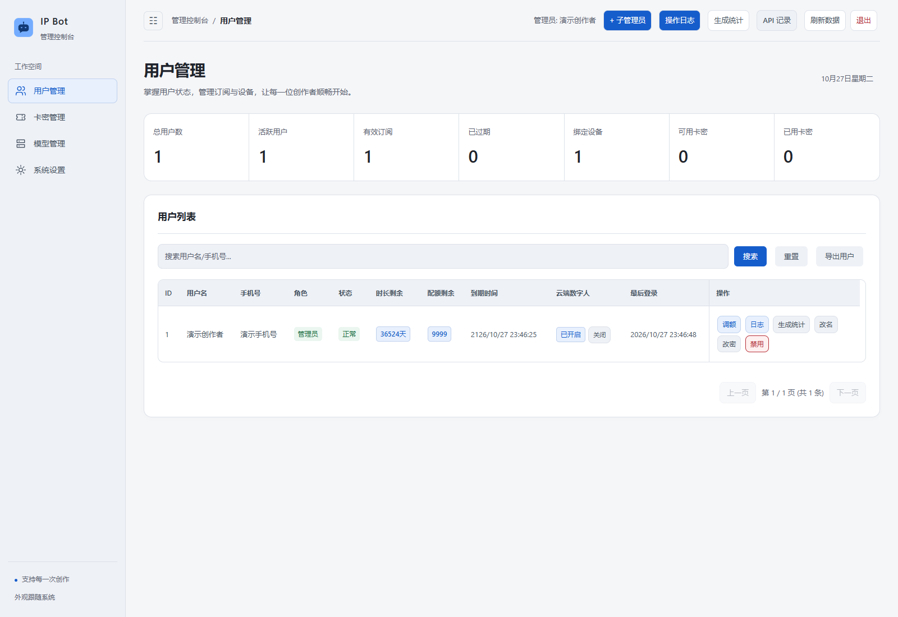
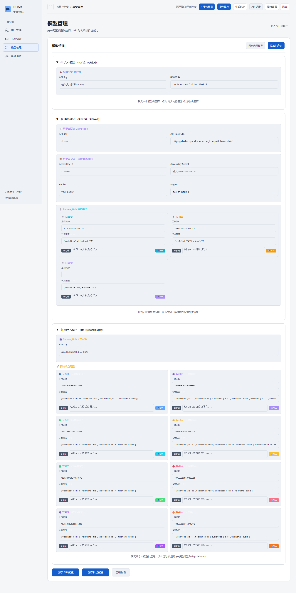
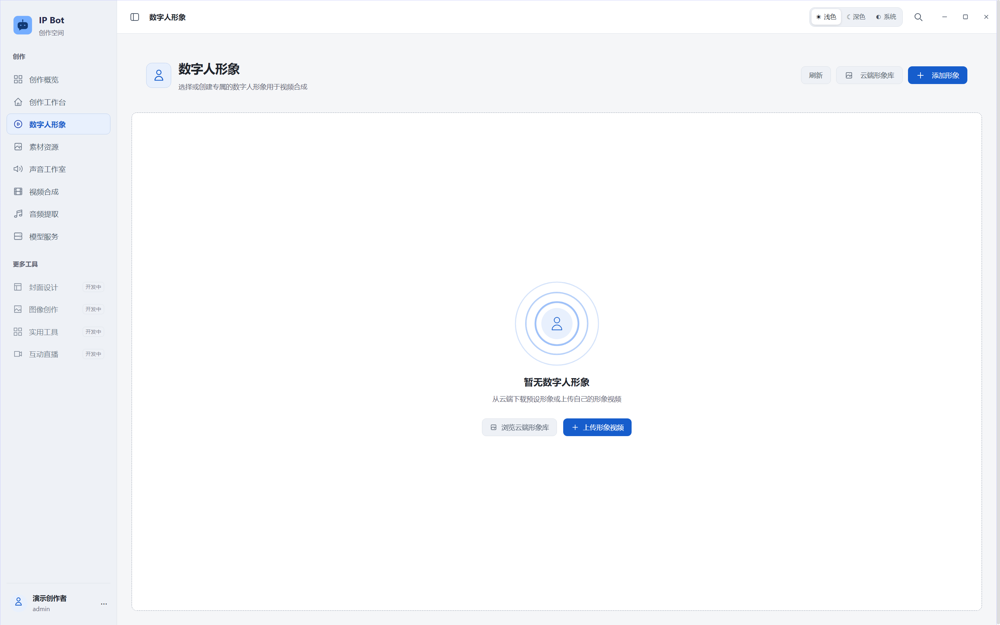
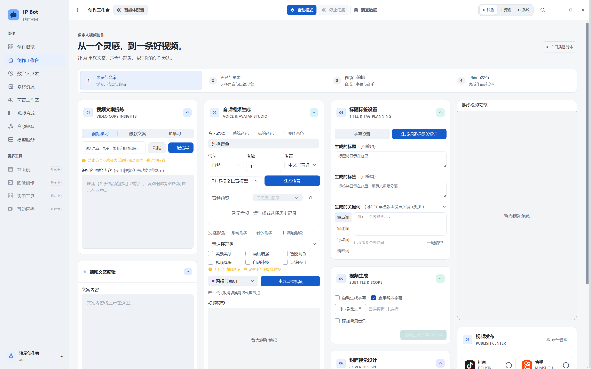

# IP Bot 安装部署教程

这份教程将维护者提供的原《安装部署教程》更新为当前源码版本的操作步骤：先准备运行环境，再启动后台与桌面端，接入文本、语音和数字人服务，最后用短素材验证。原文中的旧目录、初始账号密码和公共存储建议已更新；原 DOCX 含历史联系信息和后台截图，不随仓库发布。下方配图使用隔离演示环境。

## 开始前先选安装路线

| 情况 | 操作 |
| --- | --- |
| 第一次从 GitHub 下载 | 完成第 1～3 步；源码本身没有完整媒体资源和模型 |
| 已有合法的完整本地项目 | 可导入运行资源，再完成账号与 API 配置 |
| 使用云端数字人 | 准备云 API 与个人工作流，仍需基础音视频处理资源 |
| 使用本地数字人 | 自行准备合法的模型服务、权重、驱动与硬件，配置后单独验证 |

目前验证环境为 **Windows x64、Node.js 22.x**。其他系统、GPU 推理和安装器尚未完成验证。请为视频、模型与临时处理留出足够磁盘空间；模型的显存和驱动要求以其官方说明为准。

## Windows 双击启动方式

解压后先双击“启动后台.bat”，首次会生成自己的私有配置并安装后台依赖；等待服务启动后，再双击“启动桌面端.bat”。桌面依赖安装和原生模块准备可能需要数分钟。启动器会优先寻找已安装的 Node.js 22；找不到时会给出安装地址，并将诊断写入 logs。

缺少媒体运行资源时会提示具体缺项，桌面界面仍可打开。准备完整资源前，部分生成能力不可用。以下章节保留完整手动安装与配置方法，便于排错。

## 1 下载源码并安装依赖

安装 Node.js 22（包含 npm）和 Git，然后在 PowerShell 中执行：

~~~powershell
git clone https://github.com/pyqdcyy123-byte/ip-bot.git
cd ip-bot
node --version
npm --version
npm ci
npm --prefix user-server ci
npm run init:local
~~~

也可使用 GitHub 的 Code → Download ZIP，解压后在项目根目录打开终端，从 node --version 开始执行。不要在压缩包内部直接启动，也不要把 node_modules 从另一台电脑复制过来替代安装。

安装过程会下载 Electron 并校验 SQLite / Sharp 原生模块。初始化生成本地 sensitive.config.json 和随机 JWT_SECRET，保留已有配置。该文件与 .env 都不进入 Git。

可选：在 PowerShell 中执行 Copy-Item .env.example .env，填写自己的配置。优先级为进程环境变量 > .env 非空项 > 私有 JSON。不要把真实凭证填到示例模板里后提交。

## 2 准备媒体运行资源与可选模型

源码不含 FFmpeg/FFprobe、DLL、嵌入式 Python、u2net 等权重及本地数字人环境。这些资源既有体积要求，也有独立再分发许可。

已有完整安装时，可从另一个独立目录导入缺失资源：

~~~powershell
node scripts/import-runtime-resources.cjs "D:\your-existing-project"
# 需要本地数字人环境时再增加以下选项
node scripts/import-runtime-resources.cjs "D:\your-existing-project" --with-local-models
npm run check:runtime
~~~

导入脚本只补充缺失文件，不覆盖现有文件，不复制原账号数据库；模型生成结果与缓存也会排除。导入后路径从当前项目解析，不依赖原目录软链接。

没有现成资源时，先按 [运行资源清单](RUNTIME.md) 准备合法兼容的版本。当前仓库没有提供已核验许可的完整公开运行资源包，因此本步骤不能通过“填入 API Key”替代。只开发界面可暂用 npm run dev，浏览器模式不提供 Electron 原生处理能力。

## 3 先启动后台 再启动桌面端

在根目录打开终端 A：

~~~powershell
npm run start:server
~~~

打开 http://127.0.0.1:3002/admin 。默认仅监听本机。保留这个终端，再打开终端 B：

~~~powershell
node scripts/launch.cjs desktop
~~~

Windows 双击入口也可使用“启动后台.bat”和“启动桌面端.bat”。桌面启动器会执行资源预检并写入 logs；高级开发命令为 npm run dev:electron。更改后台地址时，同时调整 AUTH_SERVER_URL，并重启开发进程；生产界面需要重新构建。

## 4 注册自己的管理员账号

首次启动空后台数据库时，在桌面端注册账号，首位注册者自动成为管理员。不要沿用旧教程中的默认账号和密码。后续用户由管理员在后台生成卡密后注册。

用刚注册的管理员账号登录后台，确认能够看到用户管理和模型管理。普通用户的权限不同；“用户管理”只在后台出现。

## 5 配置文本模型

在后台进入“模型管理”，找到文本模型区域，配置自己已开通的服务。例如使用火山方舟 / 豆包：

1. 在自己的火山方舟项目中创建模型调用 API Key，并开通需要的模型。
2. 将 Key 填入后台文本模型配置，将模型 ID 或已创建的推理接入点 ID 填入对应模型字段。
3. 保存配置。桌面端若未更新，重新加载配置或重新登录。
4. 用简短文字执行一次改写，确认模型、地域与权限一致。

API Key 与模型/接入点 ID 是两个不同字段。控制台操作以服务商当前文档为准：[API Key 管理](https://docs.volcengine.com/docs/ark/manage-api-keys?lang=zh)、[模型调用与认证](https://docs.volcengine.com/docs/ark/base-url-and-authentication?lang=en)。

## 6 配置百炼语音与 OSS

### 百炼语音

在阿里云百炼开通所需语音模型，取得同地域的 API Key 和对应接口地址，填写后台语音模型区域。服务商区域、Key、模型与音色需要匹配；CosyVoice 与多模态语音不是同一种调用方式。

官方步骤见 [获取百炼 API Key](https://www.alibabacloud.com/help/en/model-studio/get-api-key)。后台出现的占位文本不是可用凭证，也不表示已获得模型调用权限。

### OSS 对象存储

视频识别或音色克隆的部分流程需要临时上传媒体，配置个人 OSS AccessKey ID / Secret、Bucket 与 Region。Region 字段示例为 oss-cn-beijing，不是整个 Bucket URL；Endpoint 使用服务商对应地域地址。

使用独立的 RAM 凭证和业务专用目录，按所需上传/读取及清理操作配置权限。**不要照旧教程直接关闭 Bucket 的公共访问保护。** 私有对象可以通过有时效的签名 URL 提供给识别服务，当前 OSS 上传模块包含签名 URL 实现；具体业务链路仍需用自己的短素材验证。跨域规则仅在实际浏览器直连需要时为明确来源设置，不应为了排错将所有对象设为公开可读。

官方说明：[OSS Endpoint 与 Bucket 域名](https://www.alibabacloud.com/help/en/oss/user-guide/access-oss-via-bucket-domain-name)、[私有对象与签名访问](https://www.alibabacloud.com/help/en/oss/use-a-fixed-file-url-to-access-a-file)。云端识别必须能在签名有效期内访问到该对象。

完成后使用“保存 API 配置”保存，再用简短文本试听与合成，检查个人额度、模型和音色。不要为了通过检查填写示例 Key 或使用别人的凭证。

后台模型配置整页截图

## 7 选择数字人模式并添加形象

### 云端模式

在后台填入自己的 RunningHub 或其他兼容服务配置，再匹配工作流 ID 与节点映射。页面中的示例工作流不保证在你的账号下可访问；以自己有权使用的工作流实际节点为准。配置保存后，到桌面工作台选择对应模型或节点。

### 本地模式

先准备并启动兼容的本地数字人服务，检查 GPU/驱动、模型权重、服务端口和模型自身状态，再在桌面“模型服务”中添加对应本地模型。导入模型目录不等于模型服务已经启动，也不等于 GPU 推理已验证。当前仓库没有附带完整本地模型与自动配置承诺。

接着进入“数字人形象”，添加自己有权使用、嘴部清楚且质量合适的形象素材。在工作台中选择该形象，先用短音频验证生成。

## 8 完成第一次短素材验证

~~~mermaid
flowchart TD
    A[资源预检通过] --> B[后台与桌面账号正常]
    B --> C[短文本改写成功]
    C --> D[音色试听与短语音成功]
    D --> E[短音频生成数字人成功]
    E --> F[字幕和视频导出成功]
    F --> G[再使用完整素材与自动模式]
~~~

依次验证可快速定位问题；任一阶段失败时先解决该阶段，再启用后续合成。默认导出位置为系统桌面，业务设置中可修改。

## 常见问题与检查命令

| 现象 | 优先检查 |
| --- | --- |
| 双击后没有打开 | logs 启动日志；Node 22；npm run check:runtime |
| 无法登录或获取配置 | 后台进程、AUTH_SERVER_URL、账号角色与 JWT 配置 |
| 音色选择后不能合成 | 百炼区域、Key、模型、音色匹配及服务额度 |
| 视频学习失败 | 浏览器与链接可访问性、FFmpeg、OSS/识别服务返回错误 |
| OSS 上传/读取 403 | RAM 权限、Bucket/Region、签名是否有效与临时对象访问方式 |
| 本地数字人不响应 | 模型服务是否已启动、接口地址、驱动、权重和显存要求 |
| 文件只复制了源码就不能用 | 缺少的运行资源不会随源码自动出现，返回第 2 步 |

~~~powershell
npm run check:runtime
npm test
npm run audit:source
npm run build
~~~

后台默认仅供受信任本地安装。有效客户端可以读取其服务商配置；公开多租户服务需额外安全设计。其他限制与依赖告警见 [发布状态](RELEASE_STATUS.md) 和 [安全说明](../SECURITY.md)。
